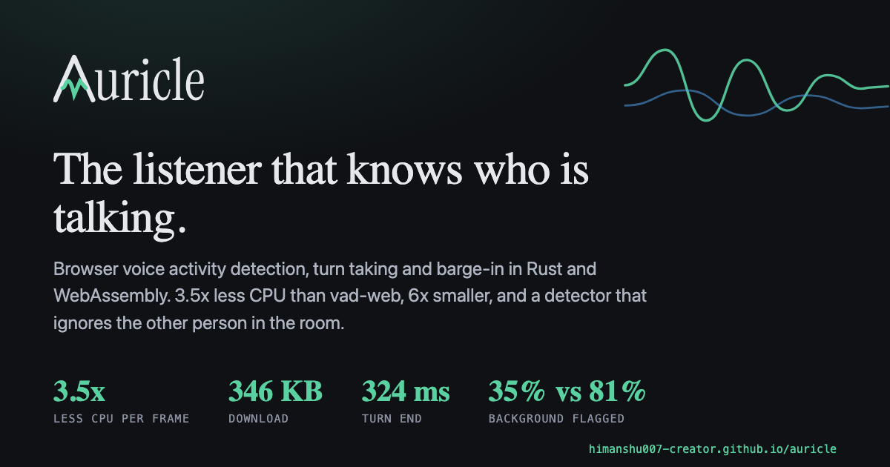
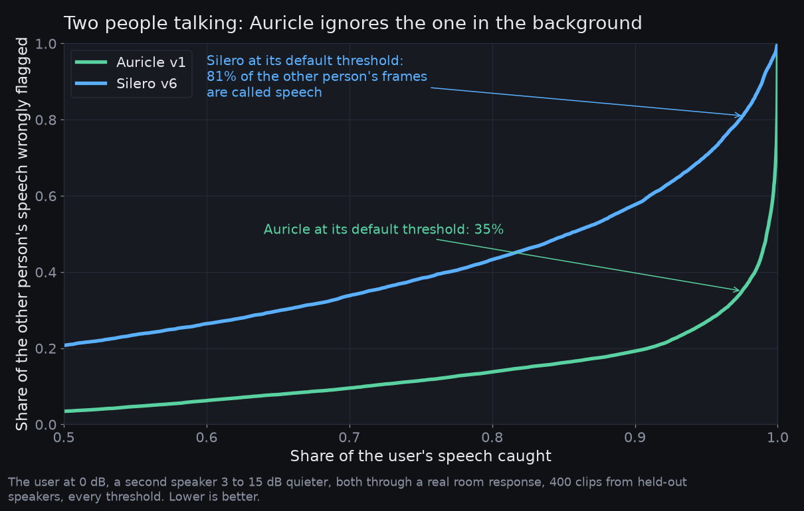

<p align="center"></p>
<p align="center"></p>

# Auricle

[](https://www.npmjs.com/package/auricle)
[](https://www.npmjs.com/package/auricle-react)
[](https://github.com/himanshu007-creator/auricle/actions/workflows/ci.yml)
[](LICENSE)
[](https://himanshu007-creator.github.io/auricle/)
[](https://huggingface.co/auricle-voice/auricle-v1)


**The listener for voice agents, in the browser.** Voice activity detection, turn taking, barge-in and ducking as one Rust program compiled to WebAssembly, with an adapter for any OpenAI-compatible speech-to-text, chat and text-to-speech API. No inference runtime, no model files to copy, one import to switch from `@ricky0123/vad-web`.

| Measured in Chromium 145 and WebKit 26 | Auricle, as shipped (Auricle v1) | Auricle engine with vad-web's Silero v6 weights | vad-web |
|---|---|---|---|
| Per 32 ms frame | **0.035 to 0.038 ms** | 0.050 to 0.052 ms | 0.18 ms |
| Start-up to a ready model | **4 to 10 ms** | 13 to 15 ms | 175 to 215 ms |
| Download, gzipped | **350 KB** | 948 KB | 5,520 KB |
| Output vs onnxruntime, same weights | | 7.8e-7 | same model |
| Turn end after the user stops, labelled set, 100% recall | **324 ms** | | 1,432 ms |
| Ducking and hard stop on interruption, heard-text history, backend adapter | yes | | no |

The detector that ships is **Auricle v1**, trained from scratch for the thing a general detector does not do: with a second talker in the room, 94.2% foreground F1 and a 35% background false-alarm rate against Silero v6's 89.4% and 82%, at equal accuracy on human-labelled single-speaker audio, tested on seven languages. Every number, with its reproduce command, is in [docs/COMPARISON.md](docs/COMPARISON.md); the model is in [docs/MODEL_CARD.md](docs/MODEL_CARD.md).

**[Try the demo](https://himanshu007-creator.github.io/auricle/)**: record segments with no key, or paste a Groq key and hold a conversation you can interrupt mid-sentence.

## Install

```sh
npm install auricle            # core
npm install auricle-react      # React hooks (peer: auricle, react >= 18)
```

Script tag, no bundler:

```html
<script src="https://cdn.jsdelivr.net/npm/auricle@0.1.0/dist/auricle.iife.js"></script>
<!-- or https://unpkg.com/auricle@0.1.0/dist/auricle.iife.js; defines window.Auricle. The script build carries both detectors (1.4 MB gzipped); the ESM build loads only the one you ask for. -->
```

## Three levels, one package

**Level 1, the detector.** Replaces vad-web in a few lines.

```ts
import { createVad } from 'auricle';

const vad = await createVad({
  onSpeechStart: ({ tMs }) => ui.listening(),        // candidate: 3 voiced frames, reversible actions
  onSpeechConfirmed: () => ui.speaking(),            // 6 of the last 10 frames: irreversible actions
  onSegment: (s) => upload(s.wav()),                 // finished segment: audio, startMs, endMs, wav()
  onMisfire: () => ui.listening(),
  onFrame: (p) => meter.set(p),                      // every 32 ms
  thresholds: { hangoverMs: 240 },                   // vad-web waits 1,400 by default
});
await vad.start();                                   // from a click: it asks for the microphone
vad.pause(); vad.resume(); vad.setThresholds({ minSpeechMs: 200 });
console.log(vad.stats.sttShare);                     // share of the session that was sent to speech-to-text
```

Every public method, option, event and type carries a JSDoc comment, so an editor or a language model sees what each one does without opening the docs.

**Level 2, coming from vad-web.** Same API, one import.

```ts
import { MicVAD, utils } from 'auricle/compat';      // was '@ricky0123/vad-web'
const vad = await MicVAD.new({ onSpeechEnd: (audio) => upload(utils.encodeWAV(audio)) });
vad.start();
```

Delete `baseAssetPath`, `onnxWASMBasePath` and the copied files. The mapping and the differences are in [docs/MIGRATING_FROM_VAD_WEB.md](docs/MIGRATING_FROM_VAD_WEB.md).

**Level 3, the whole conversation.** Any OpenAI-compatible endpoint; the listener ducks the agent on a speech candidate, stops it on confirmation, and cuts the agent's history to what the user actually heard.

```ts
import { Auricle, OpenAICompat } from 'auricle';

const auricle = await Auricle.create({
  backend: new OpenAICompat({
    baseURL: 'https://api.groq.com/openai/v1',
    apiKey,
    models: { stt: 'whisper-large-v3-turbo', llm: 'openai/gpt-oss-20b', tts: 'canopylabs/orpheus-v1-english' },
    voice: 'autumn',
  }),
  profile: 'speakers',                               // or 'headphones': different thresholds while the agent talks
});
auricle.on('state', (s) => ui.set(s));               // listening | user_speaking | thinking | agent_speaking
auricle.on('turn', (t) => log(t.clean, t.verbatim)); // clean text for the model, verbatim for debugging
auricle.on('interrupted', (e) => log(e.heardText, e.stopLatencyMs));
auricle.on('metrics', (m) => log(m.endToFirstAudioMs));
await auricle.start();
console.log(formatStats(auricle.stats));             // session 2:14 · sent to STT 0:31 (23%) · TTS chars 812, avoided 1,040 · ...
```

**What it saves, measured per session.** `auricle.stats` (and `vad.stats`, `useVad().stats`) counts what actually left the browser: milliseconds of audio sent to speech-to-text against session length, characters synthesised against characters the model wrote that the user never heard because they interrupted, and the median time an interruption took to stop the audio. Those are counts from this session's events, not estimates. Multiply them by your own vendor's per-minute and per-character rates; we do not publish a dollar figure, because rates change monthly.

React:

```tsx
import { useVad, useAuricle, useMicVAD } from 'auricle-react';

const { listening, speaking, probability, segments, stats, toggle } = useVad({ onSegment: (s) => upload(s.wav()) });
const { state, turns, agentText, heardText, stats, start, interrupt } = useAuricle({ backend });
const mic = useMicVAD({ onSpeechEnd: upload });      // the @ricky0123/vad-react shape
```

Full option and event reference: the TypeScript types in `web/src/auricle.ts`, `web/src/vad.ts`, `web/src/compat.ts` and `react/src`.

## What is in the box

| Piece | Kind | Job |
|---|---|---|
| `crates/auricle-dsp` | Rust | Polyphase resampler, ring buffer, frame chunker. No allocation in the hot path. |
| `crates/auricle-vad` | Rust | Auricle v1 behind a `Vad` trait as a hand-written forward pass, parity test against PyTorch, no runtime. Silero VAD v6 is an opt-in cargo feature (parity test against onnxruntime) kept for the engine benchmark. |
| `crates/auricle-turn` | Rust | Graded events (`speech_candidate`, `speech_confirmed`, `silence_candidate`, `speech_end`, `misfire`) and the barge-in arbiter (`duck`, `unduck`, `interrupt`). Thresholds per profile. |
| `crates/auricle-text` | Rust | Deletion-only transcript cleanup (fillers, repeats, stutters) with a subsequence verifier, plus floor-holding cues. |
| `crates/auricle-worklet` | Rust, C-ABI WASM | Capture worklet (resample to 16 kHz, 512-sample frames) and playback worklet (ring, duck in 30 ms, 15 ms fade on hard stop, played-sample counter). |
| `crates/auricle-brain` | Rust, wasm-bindgen | Worker entry point: VAD + turn machine + cleanup. |
| `crates/auricle-eval` | Rust CLI | Replays a WAV through the same crates and prints events and per-frame cost (`--silero` switches to the Silero build for the parity benchmark). |
| `web/` | npm `auricle` | `createVad`, `Auricle`, `auricle/compat`, the audio graph, Chromium AEC loopback, the OpenAI-compatible backend, curl parser, heard-text truncation. |
| `react/` | npm `auricle-react` | `useVad`, `useAuricle`, `useMicVAD`. |
| `demo/` | Vite site | The GitHub Pages site: demo, benchmarks, model card, blog. |
| `bench/` | Node, Python, Playwright | The comparison against `@ricky0123/vad-web`: engine speed, labelled-set accuracy, TEN set, browser matrix, latency. |
| `tools/` | Python, HTML | Weight export from Silero's ONNX, the Auricle v1 parity fixture, the brand and chart renderers, the Open Graph card. |

### How the pieces run

```
mic ──► capture worklet (Rust: resample, chunk) ──frames──► brain worker (Rust: VAD, turn, arbiter)
                                                                 │ duck / unduck / stop (direct MessagePort)
                                                                 ▼
speakers ◄── playback worklet (Rust: ring, duck, fade, played-sample counter) ◄── TTS chunks from the main thread
                                                                 │ played / queued counts
main thread: Auricle class ── STT, chat (SSE), TTS over fetch ── heard-text truncation of history
```

The decision to duck or stop never touches the main thread or the network. The detector runs in a worker; the audio stays in the worklets.

## The detector: Auricle v1

One detector ships in the npm packages: **Auricle v1**, our own 83,393-parameter model, 334 KB of weights, MIT, [auricle-voice/auricle-v1](https://huggingface.co/auricle-voice/auricle-v1) on Hugging Face. It scores a 16 ms hop at a time and was built for the case every voice agent meets and no general detector handles: another person, or a television, audible in the same room.

### How Auricle v1 was made

Auricle v1 was trained from scratch on public audio, with frame labels bootstrapped from Silero VAD on clean speech, and a data recipe that makes it ignore background talkers. The method, in order:

1. **Label clean speech once.** 961 hours of LibriSpeech read speech get a speech or silence label every 16 ms, decided on the clean recording with a -60 dBFS energy floor. The labels are made on audio the model will never hear.
2. **Corrupt everything the model does hear.** Each 5-second training clip is one to three utterances of one speaker with realistic gaps, then passed through, with these probabilities:
   - a measured room impulse response from RIRS_NOISES, 50% of clips;
   - MUSAN noise or music at -5 to 25 dB signal-to-noise, 85%;
   - a second talker, a different held-out speaker, 3 to 25 dB below the user, 45%, labelled as *not* speech; in a quarter of those the background is MUSAN crowd babble instead of one voice;
   - a laugh, cough, sigh or sniff from VocalSound dropped into a gap at the user's own level, labelled as not speech, 20%;
   - telephone band-limiting 20%, clipping 10%, random gain from -30 to 0 dB;
   - and 12% of clips contain no foreground speech at all, so silence under noise is learned, not assumed.
3. **Keep the clean labels.** The targets never change when the audio does. A frame where only the background talker speaks is labelled silent. The only way to score well is to learn what separates the foreground voice from every other sound, which is exactly the skill a speech-or-not detector lacks.
4. **Keep the model small and causal.** 40-band log-mel features, two causal convolutions (kernel 5, 64 channels), a two-layer GRU of 64 units, one sigmoid. No look-ahead, so the browser never waits on future audio. 83,393 parameters, 334 KB.
5. **Train on one CPU.** 20,000 steps of 128 clips, AdamW at 2e-3 with cosine decay, weight decay 1e-2, an exponential moving average of the weights, half weight on the two frames around every label change, the first 0.5 s of each clip ignored while the recurrent state settles. 9.7 hours on a six-core laptop CPU, no GPU.
6. **Check against humans, not against the labeller.** The accuracy number comes from TEN VAD's 30 human-annotated recordings. The two-talker number comes from held-out speakers through rooms the model never saw. Seven languages are measured on FLEURS. The Rust port is checked against PyTorch to within 1e-4 on the same clip.
7. **Record what failed.** Two post-training attempts, one on harder two-talker mixes and one adding ten hours each of six languages, moved nothing and were rejected. Both are in [docs/RESEARCH.md](docs/RESEARCH.md).

| On the same audio | Auricle v1 | Silero VAD v6 |
|---|---|---|
| TEN VAD human-labelled set, F1 | 92.7% | 93.6% |
| Competing talker: foreground F1 | **94.2%** | 89.4% |
| Competing talker: background frames called speech | **35%** | 82% |

<p align="center"></p>

A second talker 3 to 15 dB quieter in the same room, every threshold: at any share of the user's speech kept, Auricle v1 lets through three to four times less of the other person. On one person talking Silero v6 stays about a point ahead ([chart](demo/public/charts/pr-ten.png)). Details in [docs/COMPARISON.md](docs/COMPARISON.md#precision-recall-curves-every-threshold-at-once).

Silero VAD v6 is not in the npm packages. The Rust crate keeps it behind an opt-in `silero` cargo feature so the engine comparison against vad-web stays reproducible with identical weights. Training code: [VAD-train](https://github.com/himanshu007-creator/VAD-train); recipe, languages, negative results and caveats: [docs/MODEL_CARD.md](docs/MODEL_CARD.md) and [docs/RESEARCH.md](docs/RESEARCH.md).

## The demo

[himanshu007-creator.github.io/auricle](https://himanshu007-creator.github.io/auricle/). Without a key it is a VAD recorder: every detected segment is a playable clip, and *Play pretend agent* tests ducking and barge-in with no API. With a Groq key (defaults are filled in) it is a conversation: interrupt the agent and its bubble is cut to the words you heard. The readout under the trace shows audio sent to speech-to-text versus session length, characters synthesised versus avoided by interruption, and median stop latency. *Export* saves a local JSON bundle with events, turns and the segment audio; nothing is uploaded anywhere except to the endpoint you typed.

### Keys, CORS and plain http

- A key typed into a web page is visible to that page's code. Use a scoped or short-lived key, or a proxy.
- Browser calls need CORS headers from the endpoint. Groq sends them; self-hosted servers usually need a flag. A ten-line Cloudflare Worker that adds the real key and CORS is in [docs/MIGRATING_FROM_VAD_WEB.md](docs/MIGRATING_FROM_VAD_WEB.md)'s neighbour, the demo's Advanced panel explains failures in plain words.
- Plain `http://` endpoints are blocked from the HTTPS page except `localhost` in Chromium-based browsers.

## Build from source

Prerequisites: Rust stable with the `wasm32-unknown-unknown` target, `wasm-bindgen-cli` 0.2.129 (the version must match the crate), `wasm-opt` from binaryen, Node 22.

```sh
cargo test                       # 16 Rust tests, including both parity tests
./scripts/build-wasm.sh          # worklet + brain WASM into web/src/generated
npm install
npm test                         # vitest for web and react
npm run build                    # web (ESM, compat, IIFE, types), react, demo
npm run dev                      # the demo on a local port, library from source
```

Benchmarks: `cd bench && npm install && npm run bench`, then `npm run accuracy`, `npm run browsers`, `npm run ten`, `OPENAI_API_KEY=... npm run latency`. Each script's output is what `docs/COMPARISON.md` quotes.

Release: tag `vX.Y.Z` and the release workflow tests, builds, publishes both packages to npm with provenance, and attaches the library files to the GitHub release. Pages deploy on every push to `main`.

## Docs

- [docs/COMPARISON.md](docs/COMPARISON.md): every number against vad-web, Silero and TEN VAD, with reproduce commands.
- [docs/MODEL_CARD.md](docs/MODEL_CARD.md): Auricle v1.
- [docs/MIGRATING_FROM_VAD_WEB.md](docs/MIGRATING_FROM_VAD_WEB.md): the one-import switch and what differs.
- [docs/RESEARCH.md](docs/RESEARCH.md): what we tried, including what failed.
- [docs/ROADMAP.md](docs/ROADMAP.md): the roadmap.
- Site docs: [himanshu007-creator.github.io/auricle/docs.html](https://himanshu007-creator.github.io/auricle/docs.html). Brand files in `demo/public/brand/` (`tools/brand.py` renders them).
- [CHANGELOG.md](CHANGELOG.md).

## What is not claimed

Detection on single-speaker audio is not more accurate than Silero v6; Auricle v1 is about one F1 point below it on human-labelled recordings. The competing-talker numbers are on generated clips until a meeting-corpus benchmark is published. No Firefox or mobile numbers yet, no field false-barge-in rate, no production users: vad-web has three years of those. The demo's export exists to collect them.

## License

MIT.
