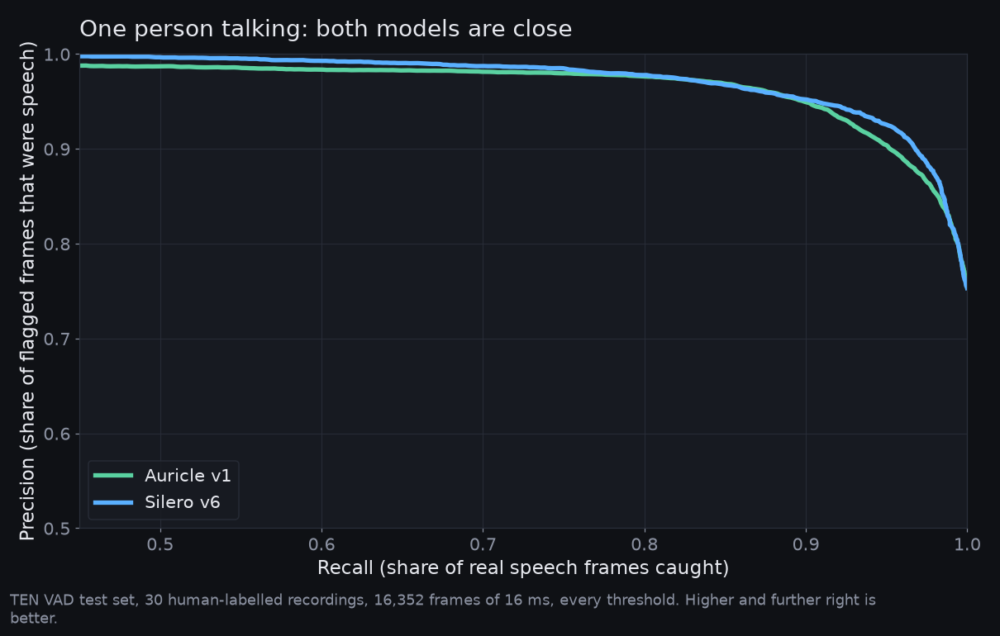

# Auricle versus `@ricky0123/vad-web`

`@ricky0123/vad-web` is the popular browser VAD. It runs the Silero model through ONNX Runtime Web. Auricle runs the same Silero v6 weights through a hand-written Rust forward pass compiled to WebAssembly. This document only states what was measured or read from the code, with the command to reproduce each number.

Measured on 2026-10-17 with `@ricky0123/vad-web` 0.0.31 and `onnxruntime-web` 1.30.0, Node 25.9 (V8 14.1) on Apple Silicon. Node runs the same WebAssembly binaries the browsers run, with the same V8 engine as Chrome, so the per-frame numbers transfer to Chromium; Safari and Firefox were not measured. Reproduce with:

```sh
./scripts/build-wasm.sh && cd bench && npm install && npm run bench
```

## Same model, same output

Both run the Silero v6 weights (`silero_vad_v6.onnx` in vad-web has the same md5 as the file Auricle exports its weights from). On the 603-frame bundled clip, the maximum absolute difference in speech probability between Auricle and onnxruntime-web is **7.8e-7**. Detection quality is therefore identical by construction; everything below is about cost and what sits around the model.

## Speed

Per 32 ms frame, one thread, four timed passes after a warm-up pass:

| Runtime | p50 | p95 | max | mean |
|---|---|---|---|---|
| Auricle brain WASM (Rust, SIMD128) | 0.051 ms | 0.060 ms | 0.48 ms | 0.053 ms |
| onnxruntime-web 1.30 WASM (SIMD, 1 thread), as vad-web runs it | 0.191 ms | 0.209 ms | 2.4 ms | 0.193 ms |

Auricle is about **3.7x faster per frame** and its worst frame was about 5x lower. Both are far below the 32 ms budget, so this buys headroom on weak devices, not a change in detection latency. Detection latency is set by frame size and confirmation policy, which the model does not control.

Startup, from first call to a ready model:

| Runtime | Time |
|---|---|
| Auricle (instantiate WASM, weights are inside it) | 28 ms |
| onnxruntime-web (instantiate runtime, create session from the ONNX file) | 195 ms |

Network time is excluded in both cases.

## Size

Gzipped bytes a page must download before the first frame can be scored:

| | gzipped |
|---|---|
| **Auricle** as shipped (Auricle v1): brain WASM with weights inside + worklet WASM | **346 KB** |
| Auricle engine with the Silero v6 weights (opt-in cargo feature, benchmark only) | 948 KB |
| vad-web: `silero_vad_v6.onnx` | 1,900 KB |
| vad-web: `ort-wasm-simd-threaded.wasm` | 3,583 KB |
| vad-web: `ort.wasm.min.mjs` + `bundle.min.js` + worklet | 37 KB |
| **vad-web total** | **5,520 KB** |

Auricle is about **16x smaller** as shipped, and still **6x smaller** when the engine carries the same Silero weights as vad-web (the single-file script build is 402 KB gzipped). The full Auricle demo page, including the TypeScript shell, is 1,040 KB gzipped. Two reasons for the gap: there is no inference runtime at all, and the STFT basis (a 258x256 matrix stored inside the ONNX file) is computed at start-up instead of shipped.

## Utility

Read from the vad-web 0.0.31 source and the Auricle source.

| Capability | vad-web | Auricle |
|---|---|---|
| Speech start / end callbacks with pre-roll audio | yes (`onSpeechStart`, `onSpeechEnd`, `preSpeechPadMs`) | yes (`speechStart`, `speechEnd`, 512 ms pre-roll) |
| Early vs. confirmed start | `onSpeechStart` then `onSpeechRealStart` after `minSpeechMs` | `speech_candidate` then `speech_confirmed` (N of last M frames) |
| Misfire callback | `onVADMisfire` | `misfire` |
| Per-frame probability | `onFrameProcessed` | `frame` |
| Where inference runs | main thread: the worklet only resamples and posts frames to `RealTimeVAD.processFrame` (real-time-vad.js) | a dedicated worker |
| Agent playback with ducking and hard stop | no | yes, in a Rust worklet: 12 dB duck in 30 ms, 15 ms fade on stop, played-sample counter |
| Control path from decision to ducking | n/a | worker to playback worklet over a direct MessagePort, no main-thread hop |
| Barge-in arbitration (duck on candidate, stop on confirm, un-duck on misfire, 800 ms cap on unclear overlap) | no | yes |
| Threshold sets that change when the agent is speaking, per speakers/headphones profile | no | yes |
| Heard-text truncation of the conversation history after an interruption | no | yes |
| Transcript cleanup with a subsequence verifier | no | yes |
| OpenAI-compatible STT, chat (SSE) and TTS adapter, curl paste, connection test | no | yes |
| Chromium AEC loopback for agent audio | no | yes |
| Offline replay of recordings through the exact browser code | no | yes (`auricle-eval`) |
| Asset handling | copy ONNX model, ORT wasm and worklet files, configure `baseAssetPath` and `onnxWASMBasePath` | WASM inlined in the JS bundle; nothing to copy |
| Models | Silero v5, v6 and legacy v4 | Auricle v1 (foreground-selective, 16 ms hop); Silero v6 as an opt-in crate feature for benchmarks |
| 8 kHz input | yes (model supports it) | no |
| Years of production use, React package, mobile and Safari fixes | yes | no; one developer, first release |

## Optimizations in the Auricle forward pass

Each row is a change made in `crates/auricle-vad/src/silero.rs` with its measured effect.

| Change | Effect |
|---|---|
| No inference runtime: the graph (reflect pad, windowed STFT, 4 conv blocks, LSTM cell, 1x1 conv, sigmoid) is plain Rust | the 3.6 MB ORT runtime and 195 ms session start disappear |
| STFT as a 256-point radix-2 FFT instead of the 258x256 basis matmul the ONNX graph uses | removes 264k of the roughly 720k multiply-adds per frame and the 264 KB basis from the payload |
| Activations stored time-major `(t, c)`, conv weights re-laid out `(cout, k, cin)` at load | every inner loop is one contiguous dot product |
| Explicit `f32x4` SIMD128 dot product with two accumulators | p50 0.186 ms to 0.051 ms per frame (3.6x) against the same code compiled without `simd128` |
| No allocation in `process()`: scratch buffers and LSTM state live in the struct | no GC pauses, no allocator calls in the audio path |
| Weights as a flat f32 blob via `include_bytes!` | 28 ms start-up; parity with onnxruntime kept at 1e-6 |

The non-SIMD number was produced by building `auricle-brain` without `-C target-feature=+simd128` and running the same bench script against it.

## Accuracy

Frame-level accuracy is identical: same weights, outputs within 1e-6. What differs is the endpointing policy on top, so that is what was measured.

**Data.** 24 files, 240 labelled utterances: six macOS `say` voices (Samantha, Daniel, Karen, Moira, Rishi, Tessa) reading ten sentences from one word ("No.", "Okay.") to 15 words, separated by gaps of 0.3, 0.5, 0.8, 1.2 and 2.0 s, each file clean and with white noise at 20, 10 and 5 dB SNR. Speech intervals are measured from the clean TTS audio with a 10 ms RMS envelope at -40 dBFS. Synthetic speech, one noise type, no reverberation, no overlapping talkers: this is a controlled test of the policies, not a field accuracy study.

**Method.** `bench/accuracy.mjs` computes the probabilities once and feeds them to Auricle's turn machine (candidate 3 frames, confirm 6 of 10, hangover 240 ms, minimum voiced duration 100 ms) and to vad-web's `FrameProcessor` with its shipped defaults (thresholds 0.3 / 0.25, `minSpeechMs` 400, `redemptionMs` 1400). A detection matches an utterance when their overlap covers at least half of the shorter of the two; a detection matching nothing is a false alarm, an utterance with two detections is a split, a detection with two utterances is a merge.

```sh
python3 bench/make_dataset.py bench/data && node bench/accuracy.mjs
```

| All 240 utterances | Auricle | vad-web defaults |
|---|---|---|
| Recall | 100% | 98.3% |
| False alarms (detections matching no utterance) | 0 | 0 |
| Utterances merged into a neighbouring detection | 76 (gaps of 0.3 s, some of 0.5 s) | 232 (every gap under 1.4 s) |
| Utterances split in two | 6, all in noisy files | 0 |
| Start event after true start, median | 72 ms | 6 ms |
| End event after true end, median | 324 ms | 1,432 ms |

Per SNR: Auricle recall 100% at every level with 0 splits clean and 2 splits each at 20, 10 and 5 dB; vad-web 98.3% at every level.

Reading this honestly:

- **Turn end.** Auricle closes a turn 1.1 s sooner. For a voice agent that is the difference between answering and dead air. The cost is merging fewer natural pauses: 0.3 s pauses inside one thought still merge, 0.5 s pauses sometimes do, 0.8 s and above always split. vad-web's 1.4 s redemption merges almost everything, which is the right choice for a dictation-style recorder and the wrong one for turn taking.
- **Splits.** The six splits are one 15-word sentence with a comma pause in the middle, in the noisy files only: noise pushes the pause's probability under the 0.35 negative threshold and the 240 ms hangover ends the turn. At the conversation layer the first half ends on "better, but", which the open-turn rule treats as unfinished and merges with the next segment before calling the model. vad-web never splits because it waits 1.4 s.
- **Turn start.** vad-web's `onSpeechStart` fires on the first frame above 0.3; Auricle's candidate needs three frames above 0.5, so vad-web's first signal is about 66 ms earlier. vad-web then waits 400 ms (`onSpeechRealStart`) before trusting it; Auricle confirms after 6 of 10 frames, about 200 to 320 ms.
- **Noise.** White noise down to 5 dB SNR produced no false alarms from either policy. Auricle also has a minimum voiced duration (`minSpeechMs`, default 100 ms); sweeping it from 0 to 450 ms on this set changed nothing until 350 ms, where it started costing recall on one-word turns, so the default stays low and the knob is there for environments with clicks and keyboard noise.
- vad-web's four misses are one-word turns ("No.", "Okay.") shorter than its 400 ms minimum.

An earlier version of this scorer matched on half of the utterance only, which counted each half of a split sentence as a false alarm; the numbers above use the corrected rule.

### Real recordings: TEN VAD's annotated test set

TEN VAD publishes 30 human-annotated recordings (LibriSpeech, GigaSpeech and DNS Challenge material, 16 kHz, labels as speech / non-speech spans). `bench/ten-testset.mjs` scores the Auricle probabilities frame by frame against those labels, each 32 ms frame labelled by its centre. This is the same model vad-web runs, so the figures apply to both.

TEN VAD itself was built from its repository (its C++ feature pipeline plus its ONNX model, through its own Python demo at the 16 ms hop) and scored on the same labels.

| Threshold | Auricle / Silero v6: precision, recall, F1 | TEN VAD: precision, recall, F1 |
|---|---|---|
| 0.3 | 91.7%, 96.1%, **93.8%** | 82.4%, 98.2%, 89.7% |
| 0.5 (Auricle default) | 93.8%, 93.7%, **93.7%** | 94.2%, 92.1%, 93.1% |
| 0.7 (Auricle while the agent speaks) | 95.3%, 90.6%, **92.9%** | 98.8%, 75.2%, 85.3% |

8,184 Silero frames of 32 ms and the matching 16 ms TEN hops, each labelled by its centre. Frame-level scoring penalises every boundary frame, so these are lower bounds on what a segment-level policy sees. TEN's README reports the opposite ordering; it compared against an earlier Silero release, and the v6 weights Auricle ships close that gap on TEN's own test set. At Auricle's thresholds Silero v6 has the higher F1; TEN is sharper at 0.7 but drops a quarter of the speech frames there.

```sh
node bench/ten-testset.mjs /path/to/ten-vad/testset [/path/to/ten-vad/outputs]
```

### Precision-recall curves, every threshold at once

<p align="center"></p>
<p align="center"></p>

Same audio, same frames, full threshold sweep. **First chart:** precision against recall on TEN VAD's 30 human-labelled recordings, 16,352 frames of 16 ms. Silero v6 sits about a point above Auricle v1 on single-speaker audio across the whole curve, and the README says so. **Second chart:** 400 five-second clips from held-out speakers with a second talker 3 to 15 dB quieter in the same room, both through a measured room response; its y axis is the share of frames where only the other talker is speaking that the model still calls speech. At every foreground recall Auricle v1 calls three to four times fewer of those frames speech than Silero v6. Dots mark threshold 0.5. The curve data is in `bench/pr-v1.json`; `python -m vadtrain.prcurve runs/v1/best.pt` in VAD-train regenerates both panels.

## Browser matrix

Re-run on 2026-10-18 with the shipped build (Auricle v1 only; the Silero rows below are the earlier like-for-like engine test):

| Auricle v1, as shipped | Chromium 145 | WebKit 26 |
|---|---|---|
| Per 32 ms frame, p50 | 0.038 ms | 0.035 ms |
| Start-up to a ready model | 4 ms | 10 ms |
| Rust worklets register and render | yes | yes |
| Demo end to end with a fake microphone (19 s clip) | 3 candidates, 3 confirmed, 3 speech ends, 0 misfires | no fake mic in headless WebKit |

The 16 ms hop and the 240 ms hangover split the clip at its two longer pauses, where the 32 ms Silero build reported one segment; both are correct readings of the clip, and the conversation layer merges open turns either way.

Real browsers via Playwright 1.58, headless, same machine, `bench/browser-matrix.mjs`. The harness page runs the brain WASM and onnxruntime-web over the clip for 20 timed passes (per-frame figures are a pass total divided by 603 frames, because browsers coarsen `performance.now()`), then registers both Rust C-ABI worklets, plays half a second through the playback worklet and reads back its `playing` messages.

```sh
cd bench && node browser-matrix.mjs        # expects the demo dev server on :5174 for the fake-mic runs
```

| | Chromium 145 | WebKit 26 (Safari engine) | Firefox |
|---|---|---|---|
| Auricle per frame, p50 (min to max) | 0.052 ms (0.051 to 0.053) | 0.050 ms (0.048 to 0.051) | not run |
| onnxruntime-web per frame, p50 | 0.182 ms (0.179 to 0.193) | 0.184 ms (0.177 to 0.192) | not run |
| Start-up to ready model, Auricle vs onnxruntime-web | 13 ms vs 215 ms | 15 ms vs 175 ms | not run |
| Output parity | 7.8e-7 | 7.8e-7 | not run |
| Rust C-ABI worklets register and render | yes, 48 kHz, playing true then false | yes, 48 kHz, playing true then false | not run |
| Demo end to end with a fake microphone | yes: the 19 s clip as mic input gave 1 candidate, 1 confirmed, 1 speech_end, 0 misfires | headless WebKit has no fake mic; not testable this way | not run |

Firefox was not run: Playwright's Firefox build (1509) exits with "Couldn't load XPCOM" on this macOS 26 machine, even when launched by hand after a forced reinstall. That is a tooling failure here, not a measured result; Firefox stays unverified. Mobile browsers were not tested.

The ratio holds in both engines that ran: about 3.5x per frame and 12x to 16x on start-up, with identical outputs. The worklet result also settles the plan's open question: raw C-ABI WASM instantiated inside an AudioWorklet works in Chromium and WebKit.

## Response latency

vad-web has no response path, so this section describes Auricle against the generic pipeline it replaces. Nothing here is a measured end-to-end figure yet: the stage timings depend on your endpoint, and the script that measures them needs your key.

After the user stops talking, a plain pipeline waits for four things in series: the silence hangover (240 ms), a speech-to-text round trip, the model's first sentence, and the TTS first byte. Auricle overlaps two of them:

| Stage | Plain pipeline | Auricle |
|---|---|---|
| Hangover | 240 ms | 240 ms, but STT already runs: transcription starts at the first silence candidate and is reused when no more speech follows (a newer silence candidate cancels the older request; an eager failure falls back to a normal request) |
| Speech-to-text | full round trip after speech end | only the part of the round trip that outlasts the hangover |
| Model | wait for the first full sentence | the first clause goes to TTS at a comma once it is 12 characters long |
| TTS | first byte | first byte, streamed PCM or WAV straight into the playback worklet |
| First turn only | TLS handshake | a warm-up request at start opens the connection |

What is not improved: a non-streaming `/audio/transcriptions` endpoint still costs one round trip after the user stops. Agents on streaming speech-to-text avoid that; it is a provider property, and the OpenAI-compatible surface Auricle targets has no streaming STT.

Measure your own numbers:

```sh
OPENAI_API_KEY=... node bench/latency.mjs      # per-stage medians against your endpoint, serial vs eager model
```

The demo's agent bubble shows the measured gap from speech end to first audio for every reply, with STT wait, first token and first audio broken out, and the `metrics` event exposes the same to library users.

## Optimizations and experiments

Each idea was scored on TEN VAD's annotated recordings or the labelled turn set before deciding. Negative results are kept so nobody repeats them.

| Idea | Why it might help | Result | Decision |
|---|---|---|---|
| Causal smoothing of the probability: EMA (0.5, 0.7), 3-frame median, 2-frame max, two-state hysteresis | Standard post-processing in VAD pipelines | Every variant lowers frame F1 below the raw output (93.73% raw; best variant 93.67%) | Not added: the LSTM state already smooths |
| 16 ms hop by scoring the last 512 samples every 256 new ones | Halves onset detection latency without changing the model | F1 drops to 89.8%, recall 83%: the recurrent state steps twice per window, outside how the weights were trained | Rejected and removed |
| Minimum voiced duration before a segment counts | Reject short noise bursts | No effect on the labelled set up to 300 ms, costs one-word turns above | Kept as a knob, default 100 ms |
| FFT STFT, explicit SIMD, time-major layout | Speed | 0.32 ms to 0.05 ms per frame, parity unchanged | Shipped |
| Eager STT during the hangover, first clause to TTS | Response latency | Mechanism verified; end-to-end figures await a live endpoint (`bench/latency.mjs`) | Shipped, on by default |


## Could a different model be the base?

Auricle uses no code from vad-web. The shared piece is the Silero model weights (snakers4/silero-vad, MIT), run by Auricle's own Rust forward pass. "A different base" therefore means a different model. The candidates:

- **TEN VAD.** Measured above on its own annotated set: at Auricle's thresholds Silero v6 scores the higher F1, so there is no accuracy reason to switch. There is also a licence reason not to: TEN VAD's licence is Apache 2.0 with added conditions that forbid deploying it in a way that enables third parties to develop or deploy applications. Auricle is a library for exactly that, so TEN VAD cannot ship inside it. It stays a benchmark reference only.
- **An own model.** Feasible as a later phase: a small recurrent network on log-mel features, trained on public speech plus noise, evaluated on TEN's annotated set and on recorded conversations. It would need weeks of data work to beat a 93.7% F1 that costs 0.05 ms per frame, and the gain for turn taking is small because the remaining errors are boundary frames, which the policy layer already absorbs.
- **No VAD at all.** End-to-end duplex speech models (speech in, speech out, no separate detector) make the question moot, but they replace the whole STT, model and TTS pipeline, which contradicts the goal of working against any OpenAI-compatible API from a browser.

The verdict from the measurements: keep Silero v6 as the base; the leverage is above it, in evidence fusion (echo ratio, agent-playing state, speaker similarity) and in the turn policy, which is where the plan's later phases already point.

## Maturity

Facts from the GitHub API and the npm registry on 2026-10-17.

| | `@ricky0123/vad-web` | Auricle |
|---|---|---|
| First release | February 2023 (repository October 2022) | not released |
| Versions published | 32, latest September 2026 | 0 |
| npm downloads, last 30 days | 1,579,015 (plus 268,429 for `@ricky0123/vad-react`) | 0 |
| GitHub stars / forks / contributors | 2,068 / 270 / 26 | not public |
| Issues open / closed | 69 / 92 | none |
| Models shipped | Silero v5, v6 and legacy v4; 8 kHz and 16 kHz | Auricle v1, 16 kHz |
| React package | yes | no |
| Automated tests | a `test/` directory with web-test-runner in the source repository | 15 Rust tests (including the onnxruntime parity test), 12 vitest tests, the three bench scripts |
| Browser coverage | not stated per browser; 1.5 M monthly installs imply broad real-world use | Chromium and WebKit headless, one manual Chrome session; no Firefox, no mobile |
| Conversation features (ducking, barge-in, heard text, backend) | none, by design | present; exercised with a fake mic and a synthetic agent, not yet with a live API in an automated test |

This is the clearest gap. vad-web has three and a half years of users finding edge cases on real devices. Auricle has one day. Nothing above changes that: choosing Auricle today means choosing a smaller, faster, more capable but unproven library.

## What is not claimed

- No claim that detection is more accurate: it is the same model, and the policy comparison was run on synthetic speech with white noise only.
- No claim about end-to-end stop latency, false barge-in rate on laptop speakers or cut-off rate with real users: the plan's targets are unmeasured, and the demo's metrics and export exist to collect them.
- No Firefox or mobile numbers.
- No claim of production maturity.
